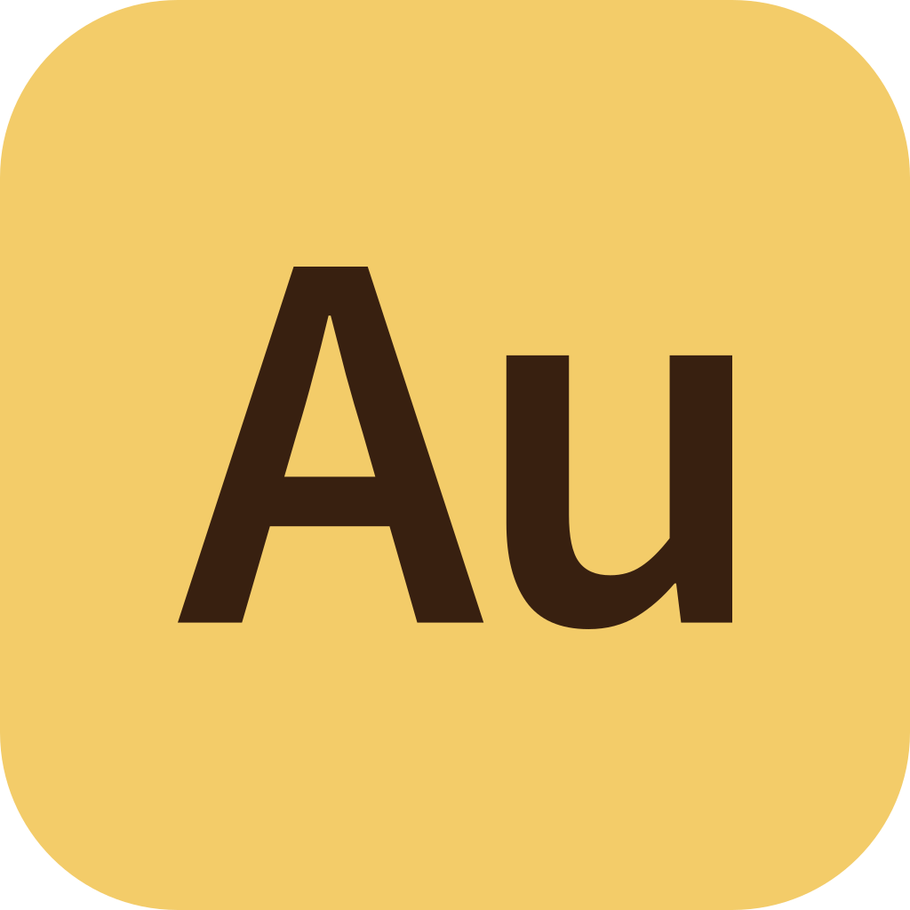
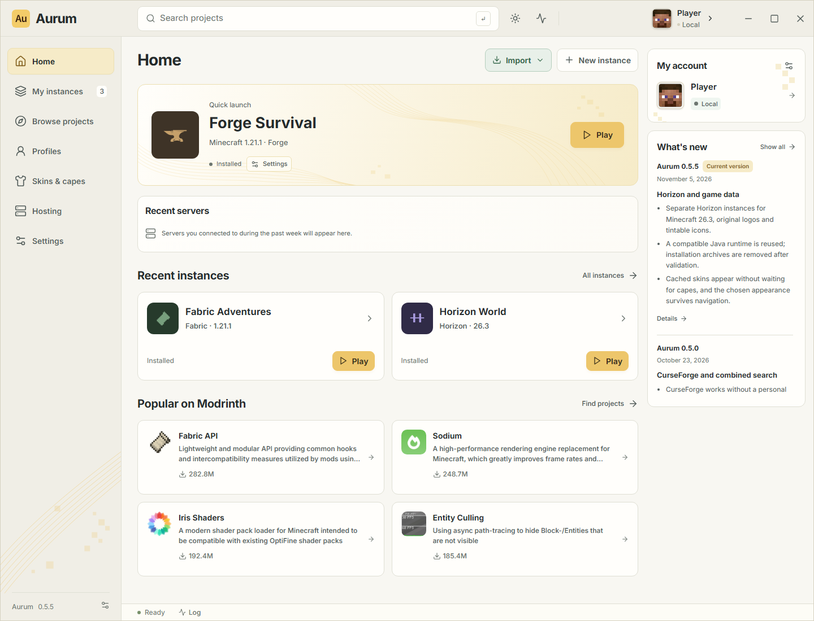
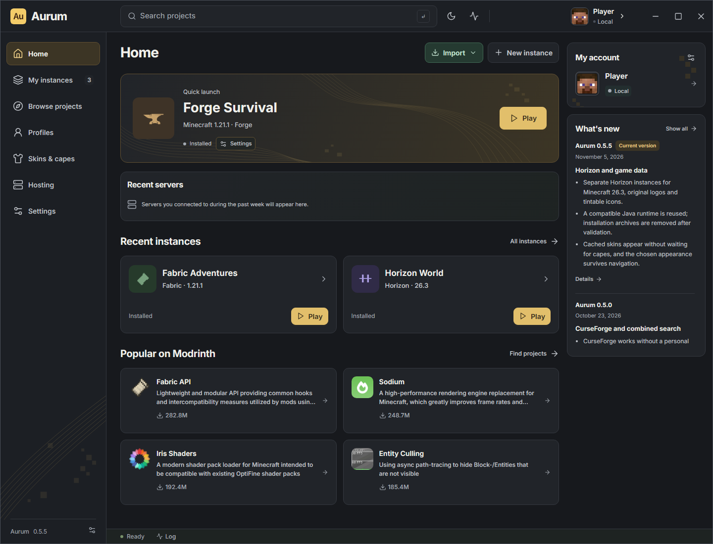

<div align="center">



# Aurum Launcher

**Minecraft Java, your instances, and your favorite mods — all in one place.**

An independent Windows launcher with a warm light theme and a graphite dark theme.

[](https://github.com/d3ede/aurum-launcher/releases/latest)
[](https://github.com/d3ede/aurum-launcher/releases/latest)
[](https://v2.tauri.app/)
[](LICENSE)

**[Download for Windows](https://github.com/d3ede/aurum-launcher/releases/latest/download/Aurum-Launcher_x64-setup.exe)** · [Website](https://d3ede.github.io/aurum-site/) · [All releases](https://github.com/d3ede/aurum-launcher/releases) · [Report an issue](https://github.com/d3ede/aurum-launcher/issues)

</div>

---

**Light theme**



**Dark theme**



*English interface with demonstration instances and a local Player profile. Project artwork is loaded from Modrinth.*

## What Aurum offers

**Aurum Social in 0.6.0 — experimental, NOT READY for general use.** Windows friend requests,
world invitations and reviewed shared-instance installation are implemented behind
explicit opt-in. Cross-network Minecraft gameplay still needs two-computer
verification. Social is optional and disabled until you enable it. Read the
[implementation and security boundaries](docs/SOCIAL.md),
[actual test results](docs/SOCIAL-TESTS.md) and
[second-computer instructions](docs/SOCIAL-TWO-PC.md).

| | Features |
| --- | --- |
| **Instances** | Separate Minecraft instances with their own mods, worlds, settings, and icons. Creating an instance starts installing the game and the appropriate Java runtime. |
| **Engines and loaders** | Java with Vanilla, Fabric, Forge, NeoForge or Quilt. Optional Horizon instances for Minecraft 26.3, downloaded separately. Original loader logos and tintable instance symbols. |
| **Mods and content** | Modrinth and CurseForge, plus public ATLauncher, FTB and Technic modpacks. Search one source or multiple compatible sources together. Install, inspect, update, toggle and remove content. CurseForge needs no personal API key. |
| **Catalog favorites** | Save projects across sources and install one, a selection, or all compatible items through a cancellable queue. See [favorites](docs/favorites.md). |
| **Horizon mods** | A separate native source catalog, explicit compilation, progress, logs and cancellation. Play offers compilation or launching without user mods when the selection has changed. |
| **Import** | Modrinth App, `.mrpack`, CurseForge ZIP and existing game folders. Originals are kept by default; recycling after a verified copy is a separate option. |
| **Accounts** | Microsoft sign-in in a dedicated window, encrypted token storage with keys in the OS credential vault, and local offline profiles. |
| **Skins and capes** | PNG library, nine default characters, wide/slim arms and animated 3D previews. Cached skins appear independently of cape downloads. Apply skins and owned capes to a Microsoft account. |
| **Local hosting** | Import server folders and proxy networks, install official server distributions including Fabric, Forge and NeoForge, use console and player controls, and manage a network with one launch button. See [local hosting](docs/local-hosting.md). |
| **Recent servers** | A weekly server history with status checks, matching-instance launches and Windows desktop shortcuts. See [recent servers](docs/recent-servers.md). |
| **Interface** | 41 languages, language search, RTL support, light and dark themes, and settings for memory, Java, and game data. |

**New in 0.6.7:** catalog favorites with queued installation, local Fabric/Forge/NeoForge server setup, and a fix for duplicate Minecraft resource downloads. [Release notes](docs/releases/v0.6.7.md).

Version [0.6.1](docs/releases/v0.6.1.md) added automatic retries after CurseForge rate limits, preserving progress and cancellation.

Version [0.6.0](docs/releases/v0.6.0.md) introduced opt-in experimental Social, customizable home layouts, five new themes and a color editor.

Horizon is experimental and requires a Microsoft account owning Java Edition. Java mods do not run in Horizon. Native mods compile into the game; the first build downloads its tools and may take 20–30 minutes or longer and several GB. Compile only trusted sources. See [compatibility and verification limits](docs/HORIZON.md).

Hosting is local, not a hosted service; keep Aurum open while its servers run. Launch caching reduces repeated preparation work, not Minecraft or mod initialization time.

## Download and install

1. Download **[Aurum-Launcher_x64-setup.exe](https://github.com/d3ede/aurum-launcher/releases/latest/download/Aurum-Launcher_x64-setup.exe)** from the latest release.
2. Run the installer and follow the setup steps.
3. Open Aurum, add an account, and create your first instance.

**Requirements:** Windows 10/11 x64, an internet connection to download the game, and Microsoft Edge WebView2 Runtime. The installer downloads WebView2 automatically if it is missing.

The installer includes the launcher and its interface. Minecraft, Java, engines, loaders and mods download separately. No manual Node.js or Rust setup is needed; optional Horizon mod compilation downloads its own toolchain.

The application executable's size is **not** its total disk footprint. Instances,
worlds, mod data, assets and Java can occupy several gigabytes. Verified Java archives are cleaned up, imports explicitly
explain copying, and the uninstaller offers optional game-data removal. See
[storage and removal](docs/STORAGE.md).

The installer does not yet have an **Authenticode publisher certificate**, so Windows may display a SmartScreen warning. Starting with **0.3.3**, Aurum checks GitHub Releases automatically and offers **Update and restart** inside the launcher. Update packages are verified with a separate cryptographic signature before installation. See [launcher updates](docs/UPDATES.md).

**Already using 0.3.1?** Install the latest version once from Releases to enable future in-app updates.

Each release includes `SHA256SUMS.txt` alongside the installer. Check a downloaded file in PowerShell:

```powershell
Get-FileHash .\Aurum-Launcher_x64-setup.exe -Algorithm SHA256
```

## Your first instance

1. Open **Profiles** and sign in with Microsoft or add a local profile.
2. Click **New instance** and choose a Minecraft version, loader, and loader version. Aurum starts installing the game files and Java.
3. Open the instance and click **Find projects** to browse content compatible with its game version and loader.
4. Launch when installation finishes. Instance settings include the game window size; Java instances also offer memory and JVM options.

Already using Modrinth App? Choose **Import → From Modrinth** on the home screen or in your library, then select your instances. Aurum copies worlds, mods, configuration, and resource packs. Add your accounts separately.

<details>
<summary><strong>Skins, languages, and data storage</strong></summary>

- **Skins and capes** lets you save multiple appearances and choose one for each account. Default textures belong to Mojang/Microsoft; see [asset provenance](src/assets/skins/README.md).
- Offline skins are launcher previews. Vanilla does not apply them in-game, and other players will not see them. Uploaded local capes are also preview-only.
- Change the language instantly in **Settings → Interface language**. Your choice is saved; new installations follow the system language.
- On Windows, game data defaults to `%APPDATA%\Aurum Launcher`, with profiles in `instances\Profile name`. Duplicate names receive a numbered suffix; characters Windows cannot use in folder names are replaced. Renaming a profile also renames its folder.
- Existing application data and UUID profile folders migrate automatically at startup, preserving worlds, mods, accounts, and settings. Migration waits until Minecraft is closed. Interrupted profile moves resume on the next launch; existing nonempty data roots are never merged automatically.
- Settings let you open the data directory or copy data into a new empty folder while preserving the original files. Custom data locations remain unchanged.
- Set `AURUM_DATA_DIR` to use a separate data directory.

</details>

## Project status

Aurum is under active development. The verified target runtime is **Windows x64**. Java installation and launch with all five loaders have been tested on Minecraft 1.21.1; compatibility with every historical version or Horizon mod is not claimed.

| Area | Current status |
| --- | --- |
| **Microsoft** | OAuth with PKCE, the sign-in window, and token storage are implemented. A complete sign-in with a real account and the application's Minecraft Services access still need manual verification. |
| **CurseForge** | Uses Aurum API with the project key stored on the server. Catalog, real mod installation, metadata/update checks and CurseForge ZIP import passed a native core smoke test against the deployed gateway. Author restrictions on third-party downloads are respected. |
| **Horizon** | Signed downloads, owner/Launch API gates, public native source installation, build-state checks and compilation cancellation are tested. Complete authenticated gameplay and full native game compilation still need manual verification. |
| **Storage and removal** | Exact-major Java reuse, verified archive cleanup, import-copy checks and optional game-data removal. Isolated installer tests cover registered custom roots and preservation of unrelated files. A clean Windows machine remains a separate verification target. |
| **Other platforms** | macOS/Linux builds have not been verified. Automatic Java downloads currently target Windows. |
| **Launcher updates** | Automatic checks, signed downloads, and in-app installation through GitHub Releases. Finish running games and launcher tasks before installing. |
| **Not yet implemented** | Modpack export. |

See **[VERIFICATION.md](docs/VERIFICATION.md)** for test results and their limits. Local profiles do not bypass authentication on official servers.

## Development

**Stack:** Tauri 2 · Rust · React 19 · TypeScript · Vite.

For a standard Windows build, install Node.js 22.12+, stable Rust, and Visual Studio C++ Build Tools with the Windows SDK.

```powershell
git clone https://github.com/d3ede/aurum-launcher.git
cd aurum-launcher
npm ci

# Build the optional Social executables and their pinned download manifest
./scripts/build-social.ps1 -DebugBuild

# Start the desktop app in development mode
npm run tauri dev

# Build a local application binary without release signing
npm run tauri build -- --no-bundle
```

Local binary: `target/release/aurum.exe`. Signed installers are built by the GitHub release workflow and appear under `target/release/bundle/nsis/*-setup.exe`. A local installer/update build requires the signing key; see [release publishing](docs/UPDATES.md). The release application embeds its interface and does not need a Vite server. When distributing the executable without an installer, keep `WebView2Loader.dll` alongside it if that file is present in the output folder.

The public Microsoft Client ID is stored in `config/microsoft-client-id.txt`. For your own application, follow the [Microsoft setup guide](docs/MICROSOFT-LOGIN.md). Passwords, tokens, and client secrets are not stored in the source tree.

<details>
<summary><strong>Checks and the local toolchain</strong></summary>

```powershell
npm run build
npm test
npx playwright install chromium
npm run test:ui
cargo test --workspace
cargo clippy --workspace --all-targets -- -D warnings
```

The original development workspace has an isolated toolchain in `.tools/`. It is excluded from Git and does not change the system PATH. If that toolchain is already prepared:

```powershell
./scripts/desktop.ps1 -Mode dev
./scripts/desktop.ps1 -Mode build
./scripts/cargo.ps1 -CargoArguments @('test', '--workspace')
./scripts/cargo.ps1 -CargoArguments @('clippy', '--workspace', '--all-targets', '--', '-D', 'warnings')
```

Native smoke tests use real Tauri/WebView2 and separate data in `.test-data/`. See the [verification report](docs/VERIFICATION.md).

To open a clean local preview, close any running Aurum window and run:

```powershell
./scripts/start-preview.ps1
```

The script opens `target/release/aurum.exe` with a fresh game-data folder and
WebView profile inside ignored `.test-data/previews/`. It does not copy installed
accounts, skins or instances, or change persistent environment variables. Running
the EXE directly uses the normal installed data location. Preview data is local
and is not included in source commits or installers.

</details>

### Repository layout

The Cloudflare API lives in [`services/aurum-api`](services/aurum-api/README.md), including local checks, the HTTP contract, and deployment instructions. All CurseForge operations use Aurum API; the project key stays in Workers secrets. The public `AURUM_API_URL` is configured in [`.env.example`](.env.example). Copy it to `.env` for a local override. Builds read `.env.example`, then `.env`, then the build environment; a process environment override takes priority at runtime. Only the public origin is embedded, and HTTPS is required. An empty origin disables CurseForge without affecting other providers or local operations.

```text
src/                 React interface, components, and localization
src-tauri/           Tauri application and desktop commands
crates/aurum-core/   Game installation, loaders, accounts, and data
config/              Public application configuration
tests/               Frontend and UI checks
scripts/             Build tools and smoke tests
docs/                Architecture, guides, and screenshots
```

The Rust crate and system identifier are `aurum-core` and `app.aurum.launcher`. Startup upgrades the previous application-data identity and OS vault keys without signing existing accounts out. A legacy identifier remains solely as a read-only migration marker.

## Documentation and feedback

- [Horizon and native mods](docs/HORIZON.md)
- [Storage, imports and uninstall](docs/STORAGE.md)
- [Modpack catalogs](docs/MODPACK-CATALOGS.md)
- [Architecture](docs/ARCHITECTURE.md)
- [Microsoft sign-in setup and verification](docs/MICROSOFT-LOGIN.md)
- [Localization and 41 languages](docs/LOCALIZATION.md)
- [Verification and known limitations](docs/VERIFICATION.md)
- [Launcher updates and release publishing](docs/UPDATES.md)
- [Issues and suggestions](https://github.com/d3ede/aurum-launcher/issues) — include your Aurum version, Windows version, and steps to reproduce. Do not include passwords or tokens.

## License

Original code, documentation, and artwork are available under **[PolyForm Noncommercial 1.0.0](LICENSE)**. Noncommercial use, modification, and redistribution are permitted under the full license terms. Preserve [NOTICE](NOTICE) when distributing copies.

This is a **source-available** project; its license is not an OSI-approved open source license. Commercial permissions require a separate agreement with the copyright holder, [d3ede](https://github.com/d3ede), who retains the right to commercialize their own version.

Third-party libraries, fonts, and assets retain their own licenses. Minecraft and Mojang/Microsoft content is not relicensed under Aurum's license. Aurum is an independent project and is not an official Mojang or Microsoft product.
