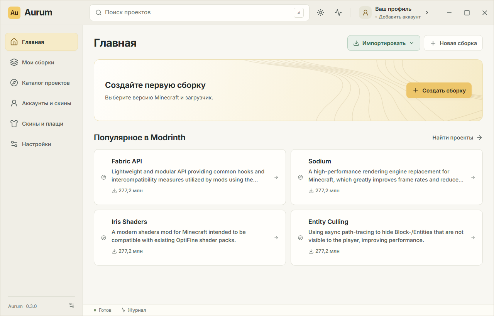

<div align="center">


# Aurum Launcher

**Minecraft Java, ваши сборки и любимые моды — в одном месте.**

Независимый лаунчер для Windows с тёплой светлой и графитовой тёмной темами.

[](https://github.com/d3ede/aurum-launcher/releases/latest)
[](https://github.com/d3ede/aurum-launcher/releases/latest)
[](https://v2.tauri.app/)
[](LICENSE)

**[Скачать для Windows](https://github.com/d3ede/aurum-launcher/releases/latest/download/Aurum-Launcher_x64-setup.exe)** · [Все релизы](https://github.com/d3ede/aurum-launcher/releases) · [Сообщить об ошибке](https://github.com/d3ede/aurum-launcher/issues)

</div>

---

<picture>
  <source media="(prefers-color-scheme: dark)" srcset="docs/screenshots/home-polish-dark.png">
  <source media="(prefers-color-scheme: light)" srcset="docs/screenshots/home-polish-light.png">
  
</picture>

*Пример интерфейса с демонстрационными данными. [Больше скриншотов](docs/screenshots).*

## Что умеет Aurum

| | Возможности |
| --- | --- |
| **Сборки** | Отдельные профили Minecraft с собственными модами, мирами, настройками и значками. Установка игры и подходящей Java при создании сборки. |
| **Загрузчики** | Vanilla, Fabric, Forge, NeoForge и Quilt; выбор совместимой версии загрузчика. |
| **Моды и контент** | Каталог Modrinth: моды, модпаки, ресурспаки и шейдеры. Установка обязательных зависимостей, обновление, отключение и удаление. Поддержка API CurseForge с вашим ключом. |
| **Импорт** | Сборки из Modrinth App, файлы `.mrpack`, CurseForge ZIP и существующие папки игры. Импорт из Modrinth сохраняет исходную сборку. |
| **Аккаунты** | Вход через Microsoft в отдельном окне, защищённое хранение токенов в хранилище ОС и локальные офлайн-профили. |
| **Скины и плащи** | Библиотека PNG-скинов, девять стандартных персонажей, широкие и тонкие руки, 3D-превью и анимации. Применение скина и доступных плащей для Microsoft-аккаунта. |
| **Интерфейс** | 41 язык, поиск языка, поддержка RTL, светлая и тёмная темы, настройки памяти, Java и расположения игровых данных. |

## Скачать и установить

1. Скачайте **[Aurum-Launcher_x64-setup.exe](https://github.com/d3ede/aurum-launcher/releases/latest/download/Aurum-Launcher_x64-setup.exe)** из последнего релиза.
2. Запустите установщик и следуйте его шагам.
3. Откройте Aurum, добавьте аккаунт и создайте первую сборку.

**Требования:** Windows 10/11 x64, интернет для загрузки игры и Microsoft Edge WebView2 Runtime. Если WebView2 отсутствует, установщик скачает его автоматически.

В установщик входят сам лаунчер и его интерфейс. Minecraft, Java, загрузчики и моды скачиваются отдельно по мере создания сборок. Node.js и Rust игрокам устанавливать не нужно.

Сборка пока **не подписана цифровым сертификатом издателя**: Windows может показать предупреждение SmartScreen. Автообновление самого лаунчера пока не реализовано; новые версии скачиваются из [Releases](https://github.com/d3ede/aurum-launcher/releases).

В каждом релизе рядом с установщиком находится `SHA256SUMS.txt`. Проверить скачанный файл можно в PowerShell:

```powershell
Get-FileHash .\Aurum-Launcher_x64-setup.exe -Algorithm SHA256
```

## Первая сборка

1. В **«Аккаунты и скины»** войдите через Microsoft или добавьте локальный профиль.
2. Нажмите **«Новая сборка»**, выберите Minecraft, загрузчик и его версию. Aurum начнёт установку игровых файлов и Java.
3. Откройте сборку и нажмите **«Найти проекты»** — каталог подберёт контент для её версии игры и загрузчика.
4. После установки запустите игру. Память, JVM и размер игрового окна можно изменить в настройках сборки.

Уже играете через Modrinth App? Нажмите **«Импортировать → Из Modrinth»** на главной или в библиотеке и выберите сборки. Aurum скопирует миры, моды, конфиги и ресурспаки; аккаунты нужно добавить отдельно.

<details>
<summary><strong>Скины, языки и хранение данных</strong></summary>

- В **«Скины и плащи»** можно сохранять несколько образов и выбирать их для каждого аккаунта. Стандартные текстуры принадлежат Mojang/Microsoft; [источники ассетов](src/assets/skins/README.md).
- Локальный офлайн-скин используется для предпросмотра в лаунчере. Vanilla не применяет его в игре, и другие игроки его не увидят. Загруженные локальные плащи также используются только в предпросмотре.
- В **«Настройки → Язык интерфейса»** язык переключается сразу и сохраняется. При новой установке используется язык системы.
- Игровые данные хранятся в системной папке приложения. В настройках её можно открыть или скопировать данные в новую пустую папку; исходные файлы сохраняются.
- Для отдельного каталога данных можно задать `AURUM_DATA_DIR`. Прежняя переменная `AUREN_DATA_DIR` также поддерживается.

</details>

## Статус проекта

Aurum находится в активной разработке. Проверенный целевой runtime — **Windows x64**. Установка и запуск пяти загрузчиков проверялись на Minecraft 1.21.1; совместимость со всеми историческими версиями не заявляется.

| Область | Текущий статус |
| --- | --- |
| **Microsoft** | OAuth с PKCE, окно входа и хранение токенов реализованы. Полный успешный вход с реальным аккаунтом и доступ приложения к Minecraft Services ещё требуют ручной проверки. |
| **CurseForge** | Нужен официальный API-ключ. Работа с реальным ключом пока не проверена; ограничения авторов на сторонние загрузки учитываются. |
| **Установщик** | NSIS-пакет собирается. Установка и удаление на чистой Windows требуют отдельной проверки. |
| **Другие платформы** | macOS/Linux пока не прошли сборку и проверку; автоматическая загрузка Java сейчас рассчитана на Windows. |
| **Пока отсутствует** | Автообновление лаунчера и экспорт модпаков. |

Подробные результаты и границы проверок: **[VERIFICATION.md](docs/VERIFICATION.md)**. Локальные профили не обходят авторизацию официальных серверов.

## Разработка

**Стек:** Tauri 2 · Rust · React 19 · TypeScript · Vite.

Для стандартной Windows-сборки нужны Node.js 22.12+, stable Rust 1.90+ и Visual Studio C++ Build Tools с Windows SDK.

```powershell
git clone https://github.com/d3ede/aurum-launcher.git
cd aurum-launcher
npm ci

# Запуск desktop-приложения в режиме разработки
npm run tauri dev

# Сборка установщика
npm run tauri build
```

Результат сборки: `target/release/bundle/nsis/*-setup.exe`. Интерфейс встроен в release-приложение; сервер Vite ему не нужен. При переносе EXE без установщика сохраняйте рядом `WebView2Loader.dll`, если она присутствует в выходной папке.

Публичный Microsoft Client ID находится в `config/microsoft-client-id.txt`; для собственного приложения следуйте [инструкции настройки Microsoft](docs/MICROSOFT-LOGIN.md). Пароли, токены и client secret в исходниках не хранятся.

<details>
<summary><strong>Проверки и локальный toolchain</strong></summary>

```powershell
npm run build
npm test
npx playwright install chromium
npm run test:ui
cargo test --workspace
cargo clippy --workspace --all-targets -- -D warnings
```

В исходном рабочем каталоге доступен изолированный toolchain в `.tools/`. Он не входит в репозиторий и не меняет системный PATH. Если такой toolchain уже подготовлен:

```powershell
./scripts/desktop.ps1 -Mode dev
./scripts/desktop.ps1 -Mode build
./scripts/cargo.ps1 -CargoArguments @('test', '--workspace')
./scripts/cargo.ps1 -CargoArguments @('clippy', '--workspace', '--all-targets', '--', '-D', 'warnings')
```

Native smoke-сценарии работают с настоящим Tauri/WebView2 и отдельными данными в `.test-data/`. Подробности — в [отчёте проверок](docs/VERIFICATION.md).

</details>

### Устройство репозитория

```text
src/                 React-интерфейс, компоненты и локализация
src-tauri/           Tauri-приложение и desktop-команды
crates/auren-core/   Установка игры, загрузчики, аккаунты и данные
config/              Публичная конфигурация приложения
tests/               Frontend- и UI-проверки
scripts/             Инструменты сборки и smoke-проверки
docs/                Архитектура, инструкции и скриншоты
```

Имя Rust-ядра `auren-core` и идентификатор `app.auren.launcher` сохранены для совместимости с ранними версиями Auren.

## Документация и обратная связь

- [Архитектура](docs/ARCHITECTURE.md)
- [Microsoft: настройка и проверка входа](docs/MICROSOFT-LOGIN.md)
- [Локализация и 41 язык](docs/LOCALIZATION.md)
- [Проверки и известные ограничения](docs/VERIFICATION.md)
- [Ошибки и предложения](https://github.com/d3ede/aurum-launcher/issues) — приложите версию Aurum, Windows и шаги воспроизведения. Не прикладывайте пароли или токены.

## Лицензия

Оригинальный код, документация и графика доступны по **[PolyForm Noncommercial 1.0.0](LICENSE)**: некоммерческое использование, изменение и распространение разрешены на условиях полного текста лицензии. При распространении сохраняйте [NOTICE](NOTICE).

Это **source-available** проект; лицензия не является open source по определению OSI. Коммерческие разрешения требуют отдельного соглашения с правообладателем: [d3ede](https://github.com/d3ede). Правообладатель сохраняет право коммерциализировать собственную версию.

Сторонние библиотеки, шрифты и ассеты сохраняют свои лицензии. Контент Minecraft и Mojang/Microsoft не перелицензируется лицензией Aurum. Aurum — независимый проект, не официальный продукт Mojang или Microsoft.
