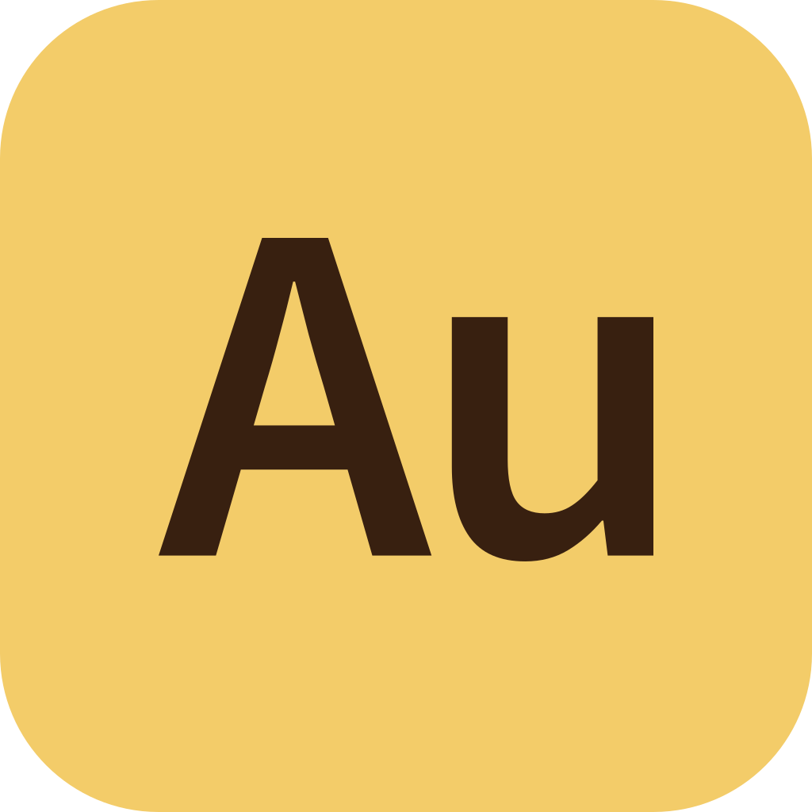
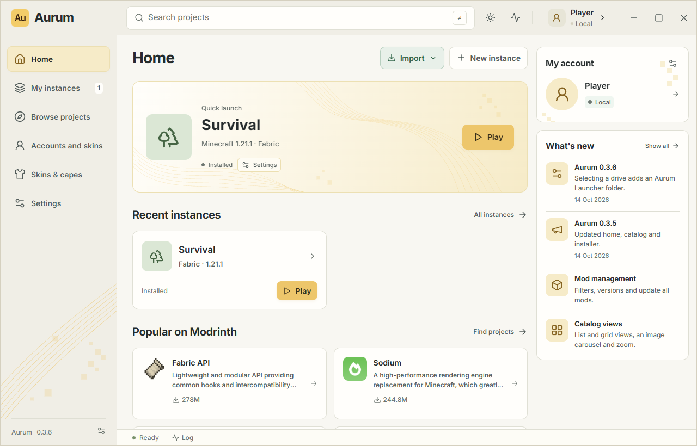

<div align="center">



# Aurum Launcher

**Minecraft Java, your instances, and your favorite mods — all in one place.**

An independent Windows launcher with a warm light theme and a graphite dark theme.

[](https://github.com/d3ede/aurum-launcher/releases/latest)
[](https://github.com/d3ede/aurum-launcher/releases/latest)
[](https://v2.tauri.app/)
[](LICENSE)

**[Download for Windows](https://github.com/d3ede/aurum-launcher/releases/latest/download/Aurum-Launcher_x64-setup.exe)** · [Website](https://d3ede.github.io/aurum-site/) · [All releases](https://github.com/d3ede/aurum-launcher/releases) · [Report an issue](https://github.com/d3ede/aurum-launcher/issues)

</div>

---



*English interface preview with demonstration data.*

## What Aurum offers

| | Features |
| --- | --- |
| **Instances** | Separate Minecraft instances with their own mods, worlds, settings, and icons. Creating an instance starts installing the game and the appropriate Java runtime. |
| **Loaders** | Vanilla, Fabric, Forge, NeoForge, and Quilt, with compatible loader versions to choose from. |
| **Mods and content** | Browse Modrinth mods, modpacks, resource packs, and shaders. Manage installed content with project icons, separate versions, search, sorting, and filters. Identify imported files, check compatible updates, update all, toggle mods, and move files to trash. CurseForge API support with your own API key. |
| **Import** | Import from Modrinth App, `.mrpack` files, CurseForge ZIP archives, or existing game folders. Modrinth imports preserve the original instance. |
| **Accounts** | Microsoft sign-in in a dedicated window, tokens stored in the OS credential vault, and local offline profiles. |
| **Skins and capes** | A PNG skin library, nine default characters, wide and slim arms, and animated 3D previews. Apply skins and owned capes to a Microsoft account. |
| **Interface** | 41 languages, language search, RTL support, light and dark themes, and settings for memory, Java, and game data. |

## Download and install

1. Download **[Aurum-Launcher_x64-setup.exe](https://github.com/d3ede/aurum-launcher/releases/latest/download/Aurum-Launcher_x64-setup.exe)** from the latest release.
2. Run the installer and follow the setup steps.
3. Open Aurum, add an account, and create your first instance.

**Requirements:** Windows 10/11 x64, an internet connection to download the game, and Microsoft Edge WebView2 Runtime. The installer downloads WebView2 automatically if it is missing.

The installer includes the complete launcher and its interface. Minecraft, Java, loaders, and mods are downloaded separately as you set up instances. Players do not need Node.js or Rust.

The installer does not yet have an **Authenticode publisher certificate**, so Windows may display a SmartScreen warning. Starting with **0.3.3**, Aurum checks GitHub Releases automatically and offers **Update and restart** inside the launcher. Update packages are verified with a separate cryptographic signature before installation. See [launcher updates](docs/UPDATES.md).

**Already using 0.3.1?** Install the latest version once from Releases to enable future in-app updates.

Each release includes `SHA256SUMS.txt` alongside the installer. Check a downloaded file in PowerShell:

```powershell
Get-FileHash .\Aurum-Launcher_x64-setup.exe -Algorithm SHA256
```

## Your first instance

1. Open **Accounts and skins** and sign in with Microsoft or add a local profile.
2. Click **New instance** and choose a Minecraft version, loader, and loader version. Aurum starts installing the game files and Java.
3. Open the instance and click **Find projects** to browse content compatible with its game version and loader.
4. Launch the game when installation finishes. Memory, JVM options, and the game window size are available in the instance settings.

Already using Modrinth App? Choose **Import → From Modrinth** on the home screen or in your library, then select your instances. Aurum copies worlds, mods, configuration, and resource packs. Add your accounts separately.

<details>
<summary><strong>Skins, languages, and data storage</strong></summary>

- **Skins and capes** lets you save multiple appearances and choose one for each account. Default textures belong to Mojang/Microsoft; see [asset provenance](src/assets/skins/README.md).
- Offline skins are launcher previews. Vanilla does not apply them in-game, and other players will not see them. Uploaded local capes are also preview-only.
- Change the language instantly in **Settings → Interface language**. Your choice is saved; new installations follow the system language.
- Game data is stored in the OS application data directory. Settings let you open it or copy data into a new empty folder while preserving the original files.
- Set `AURUM_DATA_DIR` to use a separate data directory. The legacy `AUREN_DATA_DIR` variable is also supported.

</details>

## Project status

Aurum is under active development. The verified target runtime is **Windows x64**. Installation and launch with all five loaders have been tested on Minecraft 1.21.1; compatibility with every historical version is not claimed.

| Area | Current status |
| --- | --- |
| **Microsoft** | OAuth with PKCE, the sign-in window, and token storage are implemented. A complete sign-in with a real account and the application's Minecraft Services access still need manual verification. |
| **CurseForge** | An official API key is required. Requests with a real key have not been verified yet; author restrictions on third-party downloads are respected. |
| **Installer** | The NSIS package builds successfully. Installation and removal on a clean Windows machine still need separate verification. |
| **Other platforms** | macOS/Linux builds have not been verified. Automatic Java downloads currently target Windows. |
| **Launcher updates** | Automatic checks, signed downloads, and in-app installation through GitHub Releases. Finish running games and launcher tasks before installing. |
| **Not yet implemented** | Modpack export. |

See **[VERIFICATION.md](docs/VERIFICATION.md)** for test results and their limits. Local profiles do not bypass authentication on official servers.

## Development

**Stack:** Tauri 2 · Rust · React 19 · TypeScript · Vite.

For a standard Windows build, install Node.js 22.12+, stable Rust 1.90+, and Visual Studio C++ Build Tools with the Windows SDK.

```powershell
git clone https://github.com/d3ede/aurum-launcher.git
cd aurum-launcher
npm ci

# Start the desktop app in development mode
npm run tauri dev

# Build a local application binary without release signing
npm run tauri build -- --no-bundle
```

Local binary: `target/release/aurum.exe`. Signed installers are built by the GitHub release workflow and appear under `target/release/bundle/nsis/*-setup.exe`. A local installer/update build requires the signing key; see [release publishing](docs/UPDATES.md). The release application embeds its interface and does not need a Vite server. When distributing the executable without an installer, keep `WebView2Loader.dll` alongside it if that file is present in the output folder.

The public Microsoft Client ID is stored in `config/microsoft-client-id.txt`. For your own application, follow the [Microsoft setup guide](docs/MICROSOFT-LOGIN.md). Passwords, tokens, and client secrets are not stored in the source tree.

<details>
<summary><strong>Checks and the local toolchain</strong></summary>

```powershell
npm run build
npm test
npx playwright install chromium
npm run test:ui
cargo test --workspace
cargo clippy --workspace --all-targets -- -D warnings
```

The original development workspace has an isolated toolchain in `.tools/`. It is excluded from Git and does not change the system PATH. If that toolchain is already prepared:

```powershell
./scripts/desktop.ps1 -Mode dev
./scripts/desktop.ps1 -Mode build
./scripts/cargo.ps1 -CargoArguments @('test', '--workspace')
./scripts/cargo.ps1 -CargoArguments @('clippy', '--workspace', '--all-targets', '--', '-D', 'warnings')
```

Native smoke tests use real Tauri/WebView2 and separate data in `.test-data/`. See the [verification report](docs/VERIFICATION.md).

</details>

### Repository layout

```text
src/                 React interface, components, and localization
src-tauri/           Tauri application and desktop commands
crates/auren-core/   Game installation, loaders, accounts, and data
config/              Public application configuration
tests/               Frontend and UI checks
scripts/             Build tools and smoke tests
docs/                Architecture, guides, and screenshots
```

The Rust crate name `auren-core` and identifier `app.auren.launcher` are retained for compatibility with earlier Auren versions.

## Documentation and feedback

- [Architecture](docs/ARCHITECTURE.md)
- [Microsoft sign-in setup and verification](docs/MICROSOFT-LOGIN.md)
- [Localization and 41 languages](docs/LOCALIZATION.md)
- [Verification and known limitations](docs/VERIFICATION.md)
- [Launcher updates and release publishing](docs/UPDATES.md)
- [Issues and suggestions](https://github.com/d3ede/aurum-launcher/issues) — include your Aurum version, Windows version, and steps to reproduce. Do not include passwords or tokens.

## License

Original code, documentation, and artwork are available under **[PolyForm Noncommercial 1.0.0](LICENSE)**. Noncommercial use, modification, and redistribution are permitted under the full license terms. Preserve [NOTICE](NOTICE) when distributing copies.

This is a **source-available** project; its license is not an OSI-approved open source license. Commercial permissions require a separate agreement with the copyright holder, [d3ede](https://github.com/d3ede), who retains the right to commercialize their own version.

Third-party libraries, fonts, and assets retain their own licenses. Minecraft and Mojang/Microsoft content is not relicensed under Aurum's license. Aurum is an independent project and is not an official Mojang or Microsoft product.
