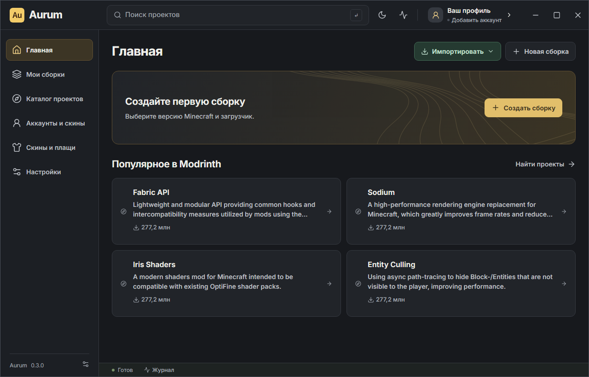
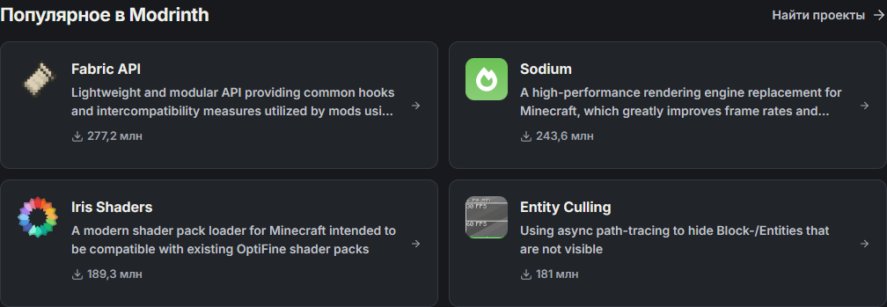

# Главная страница: Aurum 0.3.1

В карточках популярных проектов две строки описания теперь отображаются целиком. Раньше высота была 27 px при межстрочном интервале 21 px: начало второй строки выглядело как обрезки. Высота `3em` соответствует двум полным строкам; длинные описания завершаются многоточием.

На главной слева от «Новая сборка» добавлена зелёная кнопка «Импортировать». Доступны те же три способа, что в библиотеке: Modrinth App, `.mrpack`/ZIP, существующая папка игры. Главная и библиотека используют общий `ImportProfileButton`, включая блокировку при текущей операции, закрытие меню снаружи и по Escape. Цвета настроены отдельно для светлой и тёмной тем.

Проверка собранного интерфейса: четыре длинных описания, ровно 42 px под две строки, отсутствие пересечения со счётчиком загрузок, обе темы, расположение/цвет кнопки и открытие диалогов Modrinth/папки. На минимальной ширине 960 px горизонтального переполнения нет. Существующие три сценария импорта Modrinth прошли.

Проверка реального WebView2 и Rust IPC также прошла: четыре проекта с Modrinth, две полные строки, правильное расположение кнопки и открытие обоих диалогов. Ошибок JavaScript нет. После проверки открыт обычный лаунчер с пользовательскими данными, окно отцентрировано.

