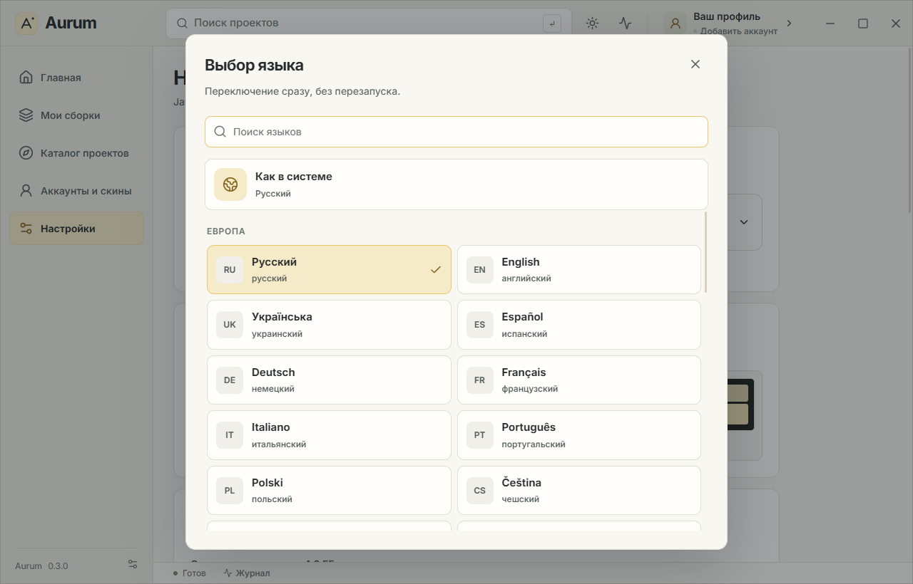

# Aurum 0.3.0: localization

Settings offer 41 languages: Russian, English, Ukrainian, Spanish, German, French, Italian, Portuguese, Polish, Czech, Slovak, Hungarian, Romanian, Bulgarian, Dutch, Swedish, Norwegian Bokmål, Danish, Finnish, Estonian, Latvian, Lithuanian, Greek, Turkish, Croatian, Slovenian, Serbian, Catalan, Icelandic, Irish, Kazakh, Arabic, Hebrew, Simplified and Traditional Chinese, Japanese, Korean, Hindi, Indonesian, Vietnamese, and Thai.

The picker shows native and localized names, and also searches by English name and language code. It supports keyboard navigation, accent-insensitive search, saved preferences, instant switching, and number/date previews. New installations follow the system language; old settings without a `language` field retain Russian. Regional variants are mapped to supported languages, with Chinese writing systems distinguished. Settings are persisted through the existing IPC database; localStorage keeps a copy for the initial render.

## Implementation

- `src/locales/registry.ts`: languages, native names, and text direction.
- `src/locales/messages/*.json`: local message packs, with English as the fallback. Other packs load on language selection without an external service or network connection.
- `src/lib/i18n.ts`: React subscriptions to message-pack changes, variable interpolation, and Intl for names, numbers, and plural forms.
- `src/components/LanguagePicker.tsx` and `src/i18n.css`: language selection, RTL, and system fonts for other writing systems.
- The interface translates known launcher messages, including Rust message templates. Instance names, paths, project titles, third-party descriptions, and original Minecraft logs retain their original text.

Core navigation and language-selection labels were reviewed manually. Other dictionaries were prepared using machine translation, followed by terminology corrections and placeholder checks. Complete review by native speakers has not been performed for every language. Translating mod descriptions is outside this version's scope.

Dictionary preparation used a local NLLB model and CTranslate2 as development tools only. The model, Python, CUDA, and temporary packages were removed from the workspace afterward; they are not included in the application. References: [NLLB](https://huggingface.co/facebook/nllb-200-distilled-600M) and [CTranslate2](https://github.com/OpenNMT/CTranslate2/blob/master/docs/guides/transformers.md). Converted package: `JustFrederik/nllb-200-distilled-600M-ct2-int8`, revision `302d78f00e6fdb50a1064059df7c392b735e9d05`. Preparation scripts are in `scripts/prepare-translations.py`; manual corrections are in `scripts/locale-overrides.cjs` and `scripts/curate-locales.cjs`. These tools are not required for a normal build or launch.

## Size and verification — October 14, 2026

The 0.3.0 installer was **6,317,494 bytes (6.32 MB / 6.02 MiB)**. The preceding 0.2.1 installer was 5,876,074 bytes. The complete updated build grew by **441,420 bytes (0.44 MB)**. This compares installer sizes, not text-only size; other application changes are also included.

SHA256 of `Aurum Launcher_0.3.0_x64-setup.exe`:

`89448103A6A35C36566A1D62C3FEE2DCAF195CA58253E706C8279C187B55E6EB`

Checks covered complete key sets and matching placeholders in all 41 dictionaries, system/regional variants, number formatting, and plural forms. Browser E2E checks instant switching RU→ES→UK→AR→ET→JA, persistence on reload, RTL at the minimum window size, and the absence of external requests during language changes. `scripts/native-localization-smoke.mjs` switches **all 41 languages through the real WebView2 interface**, verifies IPC persistence and text direction, then restarts the process and confirms the saved Spanish preference. No JavaScript errors were found.

Game checks and their limitations remain documented in [VERIFICATION.md](VERIFICATION.md), [UI-POLISH.md](UI-POLISH.md), and [MICROSOFT-LOGIN.md](MICROSOFT-LOGIN.md). Changing interface text did not require another Minecraft launch.

